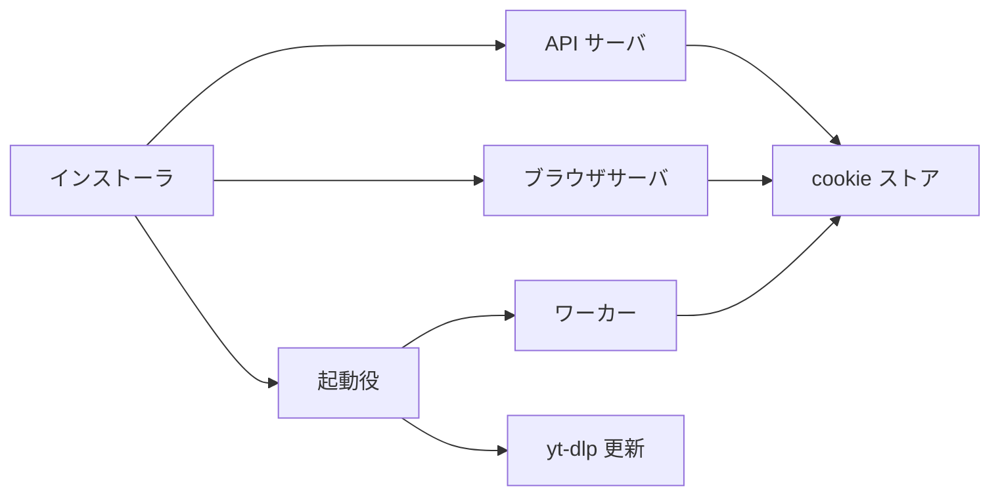
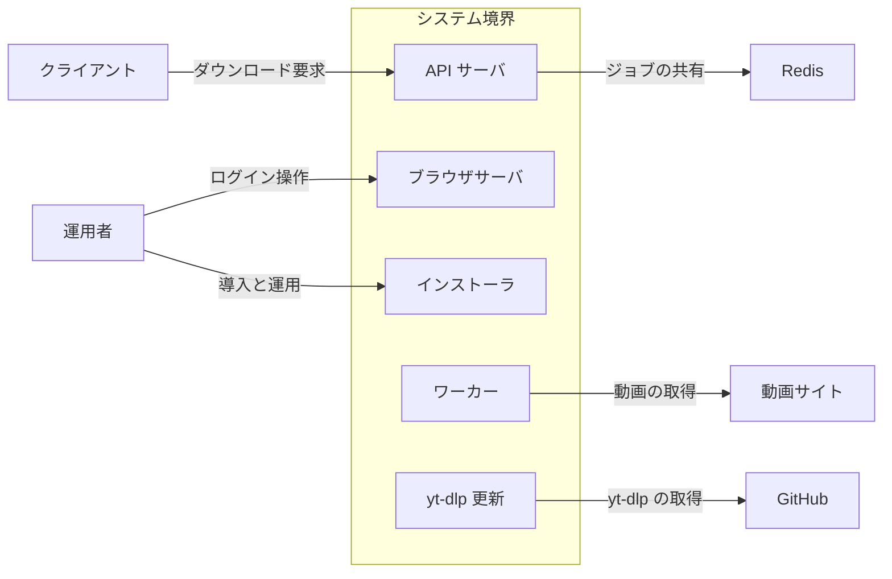
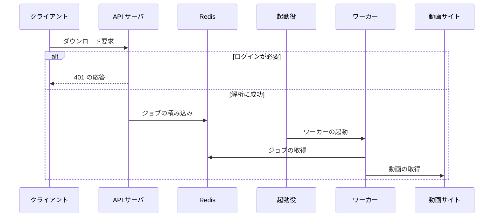
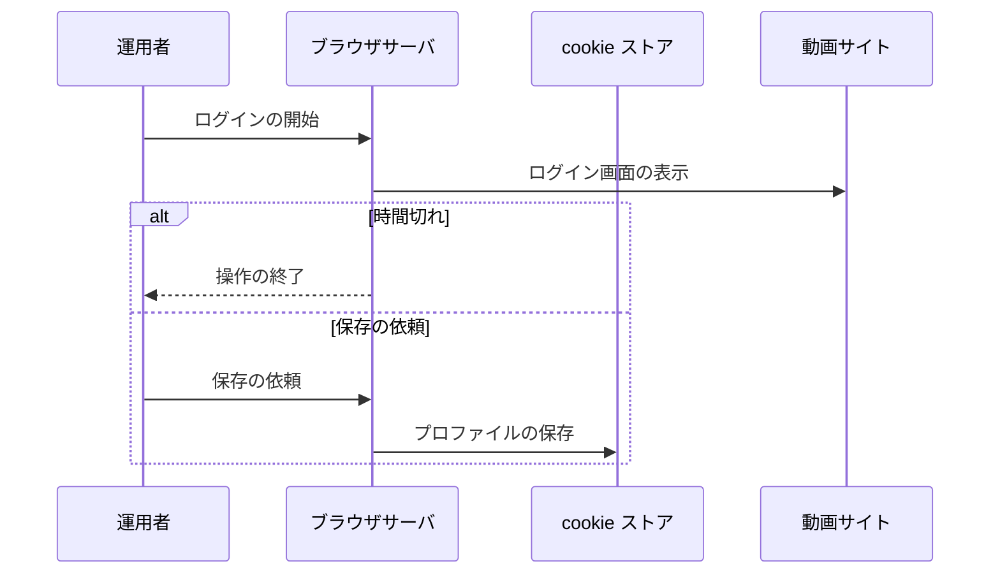
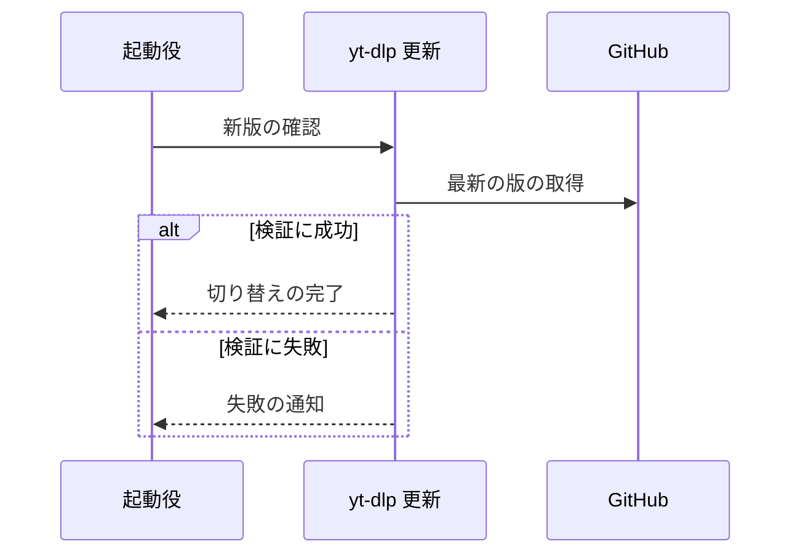
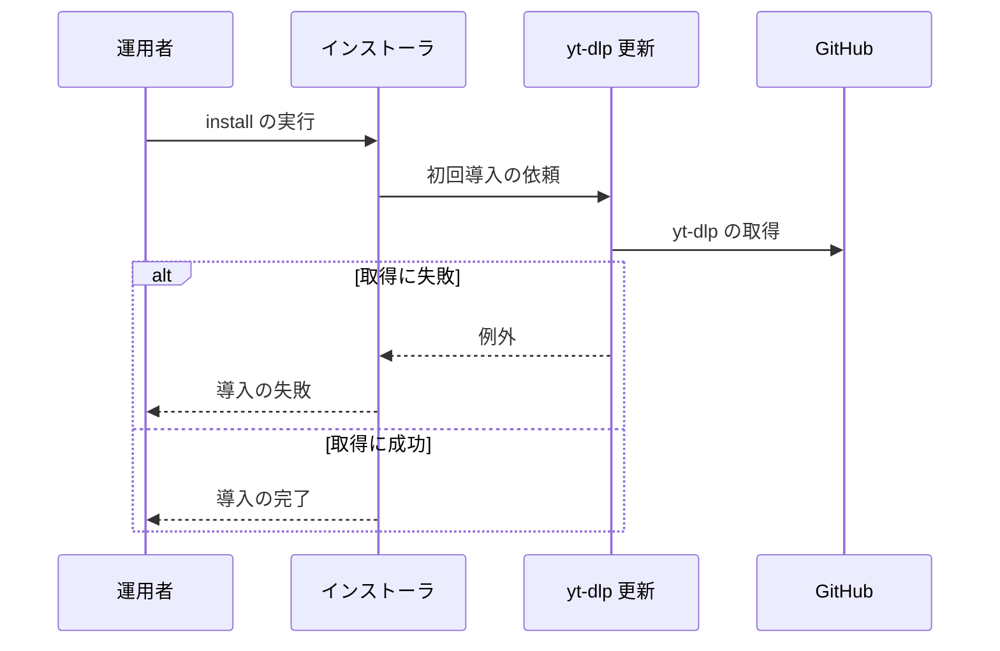

# ytdlp Server アーキテクチャ

## 1. 目的と範囲

ytdlp Server は、ネットワーク内のクライアントから受けた URL の動画を yt-dlp でダウンロードして保存する。
ログインが必要なサイトの cookie は、サーバ上のブラウザで取得して保管する。
動画サイトの公開側の仕組みと、クライアントソフトは、このシステムの対象外である。

## 2. 構成要素

| 構成要素       | 種別 | 責務                                            | 実装spec       |
| -------------- | ---- | ----------------------------------------------- | -------------- |
| クライアント   | 外部 | ダウンロードを要求し、結果を受け取る            | -              |
| 運用者         | 外部 | システムを導入し、サイトにログインする          | -              |
| Redis          | 外部 | ジョブ、リース、通知を保持する                  | -              |
| 動画サイト     | 外部 | 動画を配信し、必要なときにログインを要求する    | -              |
| GitHub         | 外部 | yt-dlp のリリースを配布する                     | -              |
| API サーバ     | 内部 | 要求を検証し、ジョブへ分解してキューへ積む      | api-server     |
| ワーカー       | 内部 | ジョブを1件取得して yt-dlp で実行し、記録する   | worker-runtime |
| 起動役         | 内部 | ジョブの有無に応じてワーカーを起動し、回収する  | dispatcher     |
| yt-dlp 更新    | 内部 | yt-dlp の新版を検証して切り替える               | ytdlp-updater  |
| cookie ストア  | 内部 | cookie プロファイルを保管し、状態を判定する     | cookie-store   |
| ブラウザサーバ | 内部 | ログイン操作を中継し、cookie を回収して保存する | browser-server |
| インストーラ   | 内部 | Ubuntu 24.04 へ全構成要素を導入する             | installer      |

## 3. システム構成

内部の要素どうしの呼び出しは、利用側から基盤へ一方向に進む。

## 4. 外部インターフェース

| IF               | 方向 | 外部の要素   | 内部の要素     | 方式              | 認証      |
| ---------------- | ---- | ------------ | -------------- | ----------------- | --------- |
| ダウンロード要求 | 提供 | クライアント | API サーバ     | HTTP（JSON）      | なし      |
| ログイン操作     | 提供 | 運用者       | ブラウザサーバ | HTTP と WebSocket | なし      |
| 導入と運用       | 提供 | 運用者       | インストーラ   | コマンド実行      | root 権限 |
| ジョブの共有     | 利用 | Redis        | API サーバ     | Redis プロトコル  | なし      |
| 動画の取得       | 利用 | 動画サイト   | ワーカー       | HTTPS             | cookie    |
| yt-dlp の取得    | 利用 | GitHub       | yt-dlp 更新    | HTTPS             | なし      |

システム境界の内側の要素と外部の要素は、IF の名前を付けた辺で結ぶ。

## 5. 機能

### ダウンロード

- 関与: クライアント, API サーバ, Redis, 起動役, ワーカー, 動画サイト

ダウンロードは、積まれたジョブを起動されたワーカーが実行する。

### ログインと cookie の保存

- 関与: 運用者, ブラウザサーバ, cookie ストア, 動画サイト

運用者が操作ページでログインすると、ブラウザサーバが cookie を回収して保存する。

### yt-dlp の更新

- 関与: 起動役, yt-dlp 更新, GitHub

起動役が更新を依頼し、yt-dlp 更新が検証に成功した版だけを切り替える。

### 導入

- 関与: 運用者, インストーラ, yt-dlp 更新, GitHub

運用者がインストーラを実行すると、yt-dlp の初回導入までを順に行う。

## 6. データ

| データ         | 保管場所                    | 書き込み主体                 |
| -------------- | --------------------------- | ---------------------------- |
| ジョブとキュー | Redis                       | API サーバ、ワーカー、起動役 |
| リース         | Redis                       | ワーカー                     |
| cookie の実体  | cookie の保存先ディレクトリ | ブラウザサーバ、ワーカー     |
| yt-dlp の版    | yt-dlp の導入先ディレクトリ | yt-dlp 更新                  |
| 動画           | 動画の保存先ディレクトリ    | ワーカー                     |

## 7. 信頼と検証

| 対象            | 信頼する前提                           | 検証手段                                           | 根拠           |
| --------------- | -------------------------------------- | -------------------------------------------------- | -------------- |
| 取得した yt-dlp | 公式リリースの資産が改ざんされていない | 同じ版のチェックサムと照合してから切り替える       | ytdlp-updater  |
| cookie の値     | 保存先のファイルを所有者だけが読める   | 権限 600 で保存し、ログと応答に値を出さない        | cookie-store   |
| 認証情報        | クライアントが認証情報を直接渡さない   | 認証関連のオプションを含む要求を拒否する           | api-server     |
| ジョブの所有者  | 記録を書くワーカーが所有者である       | 記録の前に所有者の識別子が自分と一致するか確認する | worker-runtime |

## 8. 技術基盤

| 領域               | 採用                      | 理由                                   | 根拠                  |
| ------------------ | ------------------------- | -------------------------------------- | --------------------- |
| 状態の保管         | Redis                     | ジョブの取得を原子的な操作で排他できる | worker-runtime        |
| 実行基盤           | Docker Compose と systemd | 同じ構成を2通りの方法で導入できる      | dispatcher, installer |
| ダウンロード       | yt-dlp                    | 多数の動画サイトに対応できる           | ytdlp-updater         |
| ログイン用ブラウザ | Chromium                  | 画面を配信して遠隔から操作できる       | browser-server        |

## 9. 横断的制約

| 制約                       | 値         | 根拠           |
| -------------------------- | ---------- | -------------- |
| ログイン操作の自動終了     | 900 秒     | browser-server |
| ワーカーのリースの有効期間 | 60 秒      | worker-runtime |
| yt-dlp の新版の確認間隔    | 21600 秒   | ytdlp-updater  |
| 2回目以降の install の所要 | 120 秒以内 | installer      |
