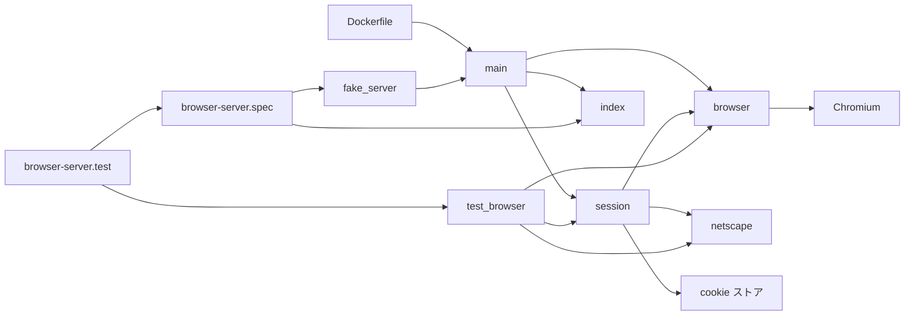
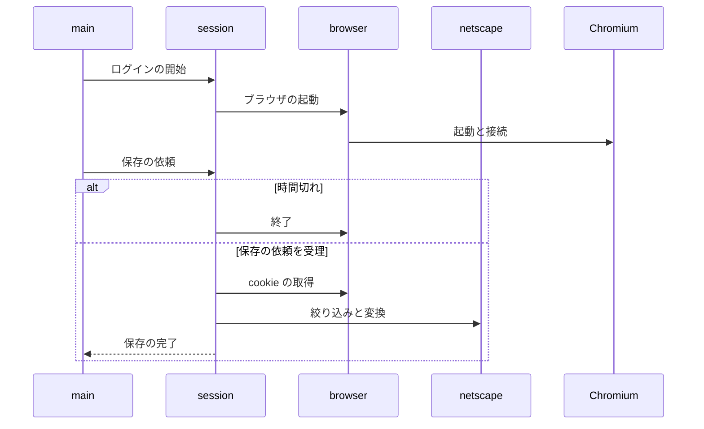

# ログイン用ブラウザ 設計書

## 1. 構成

| パス                                       | 責務                                                              |
| ------------------------------------------ | ----------------------------------------------------------------- |
| `browserServer/src/main.py`                | HTTP の制御 API、操作ページの配信、WebSocket による画面配信と入力 |
| `browserServer/src/session.py`             | ログイン操作の状態管理、時間切れ、保存、履歴の追加                |
| `browserServer/src/browser.py`             | Chromium と Xvfb の起動、CDP の通信、画面配信、入力、タブの追従   |
| `browserServer/src/netscape.py`            | cookie の絞り込みと Netscape 形式への変換                         |
| `browserServer/src/index.html`             | 操作ページ（プロファイルの選択、キャンバス、キーボード入力）      |
| `browserServer/Dockerfile`                 | 実行イメージ（Debian に chromium・xvfb・日本語フォントを導入）    |
| `tests/test_browser.py`                    | 単体テスト                                                        |
| `tests/e2e/browser-server.spec.ts`         | 操作ページを実ブラウザで検証する                                  |
| `tests/e2e/fake_server.py`                 | 実ブラウザの代わりに偽のブラウザで制御 API を起動する             |
| `tests/spec-trace/browser-server.test.mjs` | 受け入れ条件のタグ付きで単体テストと E2E を実行する               |

## 2. 関係図・ワークフロー

操作ページから cookie の保存までの依存の向きを示す。



ログインの開始から cookie の保存までと、時間切れの分岐を示す。



## 3. 設計項目

### D-1: プロセス構成とポート (FR-1, FR-9)

```text
利用者のブラウザ ──HTTP/WebSocket :8080──▶ aiohttp（常駐）
                                              │ CDP: 127.0.0.1:9222（ループバックのみ）
                                              ▼
                              Chromium（ヘッドあり）──▶ Xvfb :99（表示先のみ）
```

| 項目     | 内容                                                                                            |
| -------- | ----------------------------------------------------------------------------------------------- |
| 常駐     | aiohttp だけ。Xvfb と Chromium は開始の要求で起動し、終了時に止める                             |
| 公開     | 8080 だけ。CDP の 9222 は `--remote-debugging-address` を指定せずループバックに閉じる           |
| 環境変数 | COOKIE_DIR（既定 `/cookies`）、SESSION_TIMEOUT（既定 900）、PORT（既定 8080）、TZ、BROWSER_LANG |

### D-2: ブラウザの起動 (FR-8)

| 項目                 | 内容                                                                                                                                  |
| -------------------- | ------------------------------------------------------------------------------------------------------------------------------------- |
| 表示                 | ヘッドあり。Xvfb（1280x1000、GLX と render を有効）を表示先にする                                                                     |
| ユーザーエージェント | スマートフォン操作のときだけ起動フラグ `--user-agent` で Android の Chrome を名乗る                                                   |
| 画面サイズ           | CDP の `Emulation.setDeviceMetricsOverride` で表示領域と DPR（最大 2）に合わせる                                                      |
| WebGL                | `--use-gl=angle --use-angle=gl --ignore-gpu-blocklist`。`--disable-gpu` は使わない                                                    |
| 言語                 | `--accept-lang` に BROWSER_LANG（既定 `ja,en-US,en`）                                                                                 |
| タイムゾーン         | 環境変数 TZ をブラウザへ渡す。UTC のままなら起動時に警告を出す                                                                        |
| 共通フラグ           | `--no-sandbox` `--disable-dev-shm-usage` `--remote-debugging-port=9222` `--user-data-dir=/tmp/profile-*` `--no-first-run` `--lang=ja` |

次の制約を守る。

| 条件                                       | 結果                                                          |
| ------------------------------------------ | ------------------------------------------------------------- |
| ヘッドレス                                 | Cloudflare Turnstile に失敗する。使わない                     |
| CDP によるユーザーエージェントの上書き     | Web Worker 内の値と食い違い失敗する。起動フラグで指定する     |
| タイムゾーンが外向き IP の所在地と食い違う | X が実在アカウントのログインを制限する。TZ を所在地に合わせる |

### D-3: ログイン操作の状態 (FR-2, FR-4, FR-5, NFR-1, NFR-3)

```text
idle ──POST /session──▶ starting ──▶ running ──POST /session/commit──▶ committing ──▶ idle
                           │ 失敗 → idle        │ DELETE /session / 時間切れ → idle
                                                ◀── 対象の cookie が0件のとき running に戻る
```

| 規則     | 内容                                                                                              |
| -------- | ------------------------------------------------------------------------------------------------- |
| 同時実行 | idle 以外での開始は 409。保存中の取り消しは 409                                                   |
| 破棄     | idle に戻るときは、Chromium と Xvfb を終了し、ブラウザのプロファイルを削除し、WebSocket を閉じる  |
| 時間切れ | 開始時点から SESSION_TIMEOUT 秒で取り消しと同じ破棄を行う。0件で running に戻っても期限は延びない |
| 待機中   | ブラウザのインスタンスを生成しない                                                                |

### D-4: 制御 API (FR-1, FR-10, FR-11)

| メソッドとパス            | 内容                                                                               |
| ------------------------- | ---------------------------------------------------------------------------------- |
| `GET /`                   | 操作ページ                                                                         |
| `GET /profiles`           | `[{name, label, start_url, domains, preset, saved_at}]`。cookie の中身を含まない   |
| `DELETE /profiles/{name}` | 履歴を削除し cookie も削除する。プリセットは 400、履歴に無ければ 404、実行中は 409 |
| `GET /session`            | `{state, profile, remaining, mobile}`                                              |
| `POST /session`           | `{profile, start_url?, mobile}` で開始する                                         |
| `POST /session/commit`    | 保存。成功は `{profile, saved, domains}`、実行中でなければ 409、0件は 422          |
| `DELETE /session`         | 取り消し                                                                           |
| `GET /ws`                 | 画面配信と入力（実行中のみ）                                                       |

### D-5: プロファイルの決め方 (FR-10)

| 指定                                 | 動き                                                                              |
| ------------------------------------ | --------------------------------------------------------------------------------- |
| プロファイルがプリセットか履歴にある | 定義の開始 URL と対象ドメインを使う。開始 URL の指定は無視する                    |
| プロファイルが無く、開始 URL がある  | 新しいサイト。対象ドメインは開始 URL の登録ドメイン。保存に成功したら履歴へ加える |
| どちらも無い                         | 400                                                                               |

プロファイル名は `[A-Za-z0-9_-]{1,64}`、開始 URL は http か https のみ。プルダウンの並びはプリセット、履歴、新しいサイトの追加の順。

### D-6: 画面配信と入力 (FR-6)

| 向き          | 種類            | 内容                                                                        |
| ------------- | --------------- | --------------------------------------------------------------------------- |
| サーバ → 画面 | バイナリ        | 表示中タブの JPEG（quality 70、表示領域 × DPR）                             |
| サーバ → 画面 | `url`           | 表示中タブの URL                                                            |
| サーバ → 画面 | `probe`         | 座標の要素が入力欄か                                                        |
| 画面 → サーバ | `viewport`      | `{width, height, dpr}`。範囲は幅・高さ 240〜2000、DPR 1〜2                  |
| 画面 → サーバ | `touch`         | `Input.dispatchTouchEvent`（最大5点）                                       |
| 画面 → サーバ | `mouse` `wheel` | `Input.dispatchMouseEvent`                                                  |
| 画面 → サーバ | `text`          | ASCII 64文字以内は1文字ずつ keyDown と keyUp、それ以外は `Input.insertText` |
| 画面 → サーバ | `key`           | Enter・Backspace・Delete・Tab・Escape・矢印・Home・End                      |
| 画面 → サーバ | `nav`           | `back`、`reload`                                                            |

フレームを受け取るたびに `Page.screencastFrameAck` を返す。

### D-7: タブの追従 (FR-7)

```python
if method == "Target.targetCreated" and t["type"] == "page" and t.get("openerId"):
    await self.switch(t["targetId"])          # 新しいタブとポップアップへ切り替える
if method == "Target.targetDestroyed":
    # 表示中のタブなら、残りのページのうち先頭へ切り替える
    pages = [t for t in targets if t["type"] == "page"]
    if pages:
        await self.switch(pages[0]["targetId"])
```

切り替えるたびに、そのタブの画面サイズと入力の設定を適用し、画面配信を始め直す。

### D-8: cookie の回収と保存 (FR-3, NFR-2)

| 手順 | 内容                                                                             |
| ---- | -------------------------------------------------------------------------------- |
| 1    | `Storage.getCookies` でブラウザ全体の cookie を取得する                          |
| 2    | cookie のドメイン（先頭の `.` を除く）が対象ドメインと同じか配下のものだけを残す |
| 3    | Netscape 形式へ変換する                                                          |
| 4    | cookie ストアへ置き換えで保存する                                                |
| 5    | 新しいサイトなら履歴へ加える。ブラウザとプロファイルを破棄する                   |

| 項目                       | 規則                                                                         |
| -------------------------- | ---------------------------------------------------------------------------- |
| 行の形式                   | `domain \t include_subdomains \t path \t secure \t expires \t name \t value` |
| HttpOnly                   | ドメインの前に `#HttpOnly_` を付ける                                         |
| サブドメイン               | ドメインが `.` で始まるとき TRUE                                             |
| セッション cookie          | expires は 0                                                                 |
| 新しいサイトの対象ドメイン | 開始 URL のホストの登録ドメイン（同梱の公開サフィックス一覧で判定する）      |

cookie の値をログに出さない。ブラウザは Redis に接続しない。

### D-9: 操作ページ (FR-12)

| 入力                          | 反映                                                        |
| ----------------------------- | ----------------------------------------------------------- |
| クエリ `profile` が定義にある | プルダウンでそのプロファイルを選ぶ                          |
| クエリ `start_url` だけ       | 「新しいサイトを追加」を選び、開始 URL の入力欄に値を入れる |
| プロファイル一覧              | 各行に未保存、または保存日時を表示する                      |

## 4. エラー処理

| 事象                         | 処理                                           |
| ---------------------------- | ---------------------------------------------- |
| 実行中の開始要求             | 409                                            |
| 開始の失敗                   | ブラウザを破棄して待機状態に戻し、エラーを返す |
| 保存時に cookie が0件        | 422 を返し、実行中のまま残す                   |
| 保存中の内部エラー           | ブラウザを破棄して待機状態に戻し、500 を返す   |
| 規則に合わないプロファイル名 | 400                                            |
| CDP のイベント処理の失敗     | 警告を出して継続する                           |
