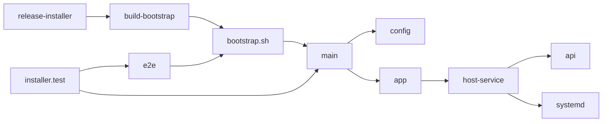
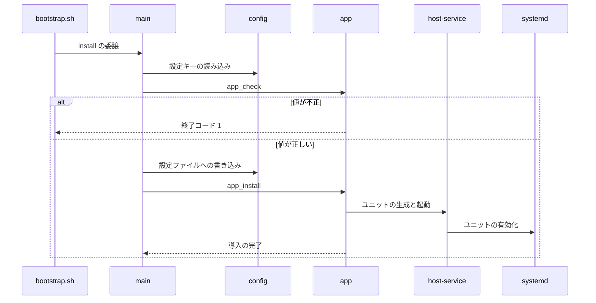

# ytdlpServer インストーラ 設計書

## 1. 構成

| パス                                      | 責務                                                                               |
| ----------------------------------------- | ---------------------------------------------------------------------------------- |
| `installer/bootstrap.sh.tmpl`             | 頒布物のひな形。依存導入、コミット固定のソース取得、本体への委譲だけを行う         |
| `installer/build-bootstrap.sh`            | ひな形へ REF・COMMIT・REPO_URL を埋め込み、頒布物を標準出力へ出す                  |
| `installer/main.sh`                       | サブコマンド、設定の検証と反映、導入メタ情報、常設コマンドの配置を行う共通の本体   |
| `installer/config.schema`                 | 設定キーの宣言（キー名・既定値・必須か・説明）                                     |
| `installer/app.sh`                        | main.sh が読み込むアプリ固有の検査・導入・撤去処理（4つのフック）。宣言は app.conf |
| `installer/host-service.sh`               | OS 判定・パッケージ・専用ユーザー・systemd ユニットの生成と起動・撤去の共通処理    |
| `installer/run/api.sh`                    | API の起動ラッパー。設定ファイルを読み、アプリ用の環境変数へ写して起動する         |
| `.github/workflows/release-installer.yml` | 検査、頒布物の生成、アーティファクト・Release への公開                             |
| `tests/installer/installer.test.mjs`      | 受け入れ条件に対応する検証。シェル検査と、使い捨てコンテナでの導入検証を実行する   |
| `tests/installer/e2e.sh`                  | 使い捨ての Ubuntu 24.04 コンテナで受け入れ条件を順に実行し、結果ファイルへ出力する |

## 2. 関係図・ワークフロー

リリースの生成から、導入先でのサービス起動までの依存の向きを示す。



導入の開始から設定の検証、失敗時に止まる分岐までを示す。



## 3. 設計項目

### D-1: install の導入手順 (FR-1)

main.sh は設定ファイルへ書き込む前に `app_check` を呼び、書き込んだ後に `app_install` を呼ぶ。`app_install` は次の順に関数を呼ぶ。各関数は何度実行しても同じ結果になる。

| 順  | 関数                | 処理                                                                                |
| --- | ------------------- | ----------------------------------------------------------------------------------- |
| 1   | `check_env`         | Ubuntu 24.04 であること、systemd で動いていること、メモリが 1024MB 以上かを確認する |
| 2   | `install_packages`  | apt で依存（未導入のものだけ）と NodeSource の Node.js 24 を導入する                |
| 3   | `setup_dirs`        | 専用ユーザーを作り、データ・動画・cookie の保存先をそのユーザーの所有にする         |
| 4   | `setup_python`      | `$DIR/venv` を作り、各サーバの requirements を導入する                              |
| 5   | `setup_ytdlp`       | updater を実行して yt-dlp を `$DIR/ytdlp` へ導入し、専用ユーザーの所有にする        |
| 6   | `setup_pot`         | bgutil と同じ版の pot-provider を `$DIR/pot-provider` へ取得してビルドする          |
| 7   | `setup_redis`       | redis-server を 127.0.0.1 限定にする                                                |
| 8   | `start_core`        | redis-server を有効化し、pot・api・dispatcher のユニットを生成して再起動する        |
| 9   | `converge_optional` | 任意コンポーネントを設定に合わせて導入する                                          |
| 10  | `hs_prune`          | この実行で生成しなかった ytdlpserver のユニットを停止・無効化・削除する             |

```sh
. "$SCRIPT_DIR/host-service.sh"   # app.sh の先頭で共通処理を読み込む
```

### D-2: 設定ファイルと優先順位 (FR-2, FR-3)

設定ファイルは `/etc/ytdlpserver/ytdlpserver.env`（権限 640・グループ ytdlpserver、`KEY='VALUE'` 形式）。優先順位は `--set`、環境変数、既存ファイル、既定値の順。環境変数と引数指定で受け付けるのはスキーマに宣言したキーだけである。

```text
DOWNLOAD_DIR|/mnt|optional|動画の保存先
COOKIE_DIR|/var/lib/ytdlpserver/cookies|optional|cookie プロファイルの保存先
WORKER_MAX|1|optional|同時に動く worker の最大数
API_PORT|5000|optional|API の待ち受けポート
POT_PORT|4416|optional|pot-provider の待ち受けポート（127.0.0.1 限定）
REDIS_TTL|604800|optional|ジョブ情報の保持秒数
RETRY_COUNT|5|optional|ダウンロードの再試行回数
YTDLP_REPO|yt-dlp/yt-dlp|optional|yt-dlp の取得元 GitHub リポジトリ
UPDATE_INTERVAL|21600|optional|yt-dlp の新版の確認間隔（秒）
UPDATE_RETRY_INTERVAL|1800|optional|確認失敗後の再確認間隔（秒）
UPDATE_COOLDOWN|1800|optional|probe 失敗による確認依頼の最短間隔（秒）
KEEP_VERSIONS|2|optional|導入先に残す yt-dlp の版数
DISPATCH_SCAN_INTERVAL|30|optional|dispatcher がジョブを定期確認する間隔（秒）
LEASE_TTL|60|optional|worker のリースの有効期間（秒）
HEARTBEAT_INTERVAL|10|optional|worker がリースを更新する間隔（秒）
STOP_GRACE|20|optional|停止指示から強制終了までの猶予（秒）
INPROGRESS_STALE|21600|optional|所有者不明の処理中ジョブを回収するまでの秒数
WITH_BROWSER|1|optional|1 でログイン用ブラウザを導入する
BROWSER_PORT|8080|optional|ログイン操作画面のポート
BROWSER_UI_URL||optional|login_url の基準 URL（空なら外向き IP から組み立てる）
SESSION_TIMEOUT|900|optional|ログイン操作の自動終了までの秒数
BROWSER_LANG|ja,en-US,en|optional|ブラウザの言語
BROWSER_TZ|Asia/Tokyo|optional|ブラウザのタイムゾーン
WITH_NGINX|0|optional|1 で nginx（443、自己署名証明書）を導入する
SSL_CN|localhost|optional|自己署名証明書の CN
WITH_CLOUDFLARED|0|optional|1 で cloudflared を導入する
CLOUDFLARE_TOKEN||optional|Cloudflare Tunnel のトークン
WITH_REDIS_UI|1|optional|1 で Redis の Web UI を導入する
REDIS_UI|insight|optional|insight または commander
REDIS_INSIGHT_VERSION|3.8.0|optional|ビルドする Redis Insight のタグ
RI_BUILD_STORAGE|auto|optional|ビルド先（tmpfs・disk・auto）
REDIS_UI_HOST|0.0.0.0|optional|Web UI の待ち受けアドレス
```

### D-3: 値の検査 (FR-4)

`app_check` は設定ファイルへ書き込む前に、`config_value` で各キーに決まる値を読んで検査し、失敗したら `die` で終了コード 1 にする。不正な値は設定ファイルに残らない。

| 対象                               | 条件                                              |
| ---------------------------------- | ------------------------------------------------- |
| WORKER_MAX、各ポート、各秒数、版数 | 数字のみ。WORKER_MAX は 1 以上                    |
| YTDLP_REPO                         | `所有者/リポジトリ` の形                          |
| REDIS_UI                           | insight または commander                          |
| RI_BUILD_STORAGE                   | tmpfs、disk、auto のいずれか                      |
| REDIS_INSIGHT_VERSION              | 英数字と `.` `_` `-` のみ                         |
| WITH\_\* と WITH_REDIS_UI          | 0 または 1                                        |
| DOWNLOAD_DIR                       | 絶対パスで、`/var/lib/ytdlpserver` の配下ではない |
| WITH_CLOUDFLARED が 1              | CLOUDFLARE_TOKEN が空でない                       |

### D-4: update (FR-5)

```text
ytdlpserver-ctl update [--ref 名前] [--set K=V ...]
  1. 導入メタ情報の参照と REPO_URL を読む（--ref があればその名前をブランチ・タグへ解決する）
  2. 取得先のソースを参照の最新へ fetch して checkout する
  3. 新しい main.sh を exec し、サブコマンド update とコミットを渡す
  4. 設定: スキーマの新キーを既定値で追記する。既存の値は --set と環境変数で指定されたものだけ上書きする
  5. app_install を実行する（D-1 と同じ。ビルド済みの成果物は再ビルドしない）
```

頒布物の update は導入済みの `ytdlpserver-ctl update` へ委譲し、頒布物のコミットへは戻さない。

### D-5: 任意コンポーネントの収束 (FR-6)

`converge_optional` は、有効なコンポーネントを導入してユニットを生成する。無効なコンポーネントのユニットは、最後の `hs_prune` が撤去する。

| 設定             | 1 のとき                                                             | 0 のとき                                |
| ---------------- | -------------------------------------------------------------------- | --------------------------------------- |
| WITH_BROWSER     | Playwright の chromium、xvfb、フォントを導入し、ユニットを有効化する | ユニットを停止・無効化・削除する        |
| WITH_NGINX       | nginx と自己署名証明書を導入し、リバースプロキシ設定を置く           | 設定を撤去して nginx を停止・無効化する |
| WITH_CLOUDFLARED | 最新版を取得し、ダイジェストを検証して導入する                       | ユニットを停止・無効化・削除する        |
| WITH_REDIS_UI    | REDIS_UI の種類の Web UI を導入する                                  | ユニットを停止・無効化・削除する        |

```text
WITH_BROWSER=1 でメモリ 2048MB 未満またはルート空き 1024MB 未満:
    引数指定・環境変数で WITH_BROWSER が明示されているなら警告して続行する
    明示されていないなら警告して無効にする（設定ファイルの値は変えない）
REDIS_UI=insight:
    Node.js 24 以上、メモリ 1800MB 以上、作業領域の条件を満たしビルドが成功すれば Redis Insight を使う
    満たさない、または失敗したら警告して redis-commander で継続する
```

### D-6: uninstall と purge (FR-7, FR-8)

| 対象                                                          | uninstall | purge を付けたとき |
| ------------------------------------------------------------- | --------- | ------------------ |
| ytdlpserver の全ユニット（停止・無効化・削除）                | 削除      | 削除               |
| 専用ユーザー ytdlpserver                                      | 残す      | 削除               |
| 常設コマンド、取得先（venv、pot-provider、yt-dlp を含む）     | 削除      | 削除               |
| nginx の設定、cloudflared のバイナリ、yt-dlp のプラグイン設定 | 削除      | 削除               |
| 設定ファイル（`/etc/ytdlpserver`）                            | 残す      | 削除               |
| cookie の保存先、`/var/lib/ytdlpserver`                       | 残す      | 削除               |
| Redis のデータ（`/var/lib/redis` 直下のデータファイル）       | 残す      | 削除               |
| 導入メタ情報（`/var/lib/ytdlpserver-installer`）              | 残す      | 削除               |
| 動画の保存先                                                  | 残す      | 残す               |
| apt で導入したパッケージ                                      | 残す      | 残す               |

purge の Redis データ削除は redis-server を停止してから行う。COOKIE_DIR が既定以外の場所でも、purge はその場所を削除する。

### D-7: status (FR-9)

```text
導入済み:                         未導入:
導入先:     /opt/ytdlpserver      未導入
導入方式:   system
参照:       dev/v1.3（branch）
コミット:   <40桁>
取得元:     https://github.com/<owner>/<repo>.git
更新日時:   2026-10-12T01:00:00Z
設定:       /etc/ytdlpserver/ytdlpserver.env
```

### D-8: サービス構成 (FR-10)

ytdlpserver のユニットは host-service.sh の `hs_service` が生成する。実行ユーザーは ytdlpserver、自動再起動は `Restart=always`・`RestartSec=3` である。

| ユニット                | 依存                          | 待ち受け                      | 実行ユーザー |
| ----------------------- | ----------------------------- | ----------------------------- | ------------ |
| redis-server            | network                       | 127.0.0.1:6379                | redis        |
| ytdlpserver-pot         | network                       | 127.0.0.1:POT_PORT            | ytdlpserver  |
| ytdlpserver-api         | redis-server、ytdlpserver-pot | 0.0.0.0:API_PORT              | ytdlpserver  |
| ytdlpserver-dispatcher  | redis-server、ytdlpserver-pot | なし（worker を子として起動） | ytdlpserver  |
| ytdlpserver-browser     | network                       | 0.0.0.0:BROWSER_PORT          | ytdlpserver  |
| ytdlpserver-redis-ui    | redis-server                  | REDIS_UI_HOST:5540            | ytdlpserver  |
| ytdlpserver-cloudflared | ytdlpserver-api               | なし                          | ytdlpserver  |

```sh
hs_service ytdlpserver-api --description "ytdlpServer API" --user ytdlpserver \
  --requires redis-server --after ytdlpserver-pot -- "$DIR/installer/run/api.sh"
hs_start ytdlpserver-api
```

### D-9: CI の公開 (FR-11, NFR-3)

| ジョブ      | 条件                | 内容                                                               |
| ----------- | ------------------- | ------------------------------------------------------------------ |
| check       | 全トリガー          | installer-check.yml（起動ラッパーの検査と静的検査）                |
| build       | check の成功後      | 頒布物と SHA256 の生成、構文検査、shellcheck、アーティファクト保存 |
| release-tag | タグ名が v で始まる | Release を作成または再利用し、頒布物を上書き添付する               |

トリガーは push（全ブランチと v\* タグ）と手動実行。

### D-10: 頒布物のコミット固定 (FR-12)

```sh
git -C "$DIR" fetch -q --depth 1 origin "$COMMIT"
git -C "$DIR" checkout -q --detach FETCH_HEAD
[ "$(git -C "$DIR" rev-parse HEAD)" = "$COMMIT" ] || die "取得したソースが期待するコミットと一致しません"
exec sh "$DIR/installer/main.sh" "$SUB" --ref "$REF" --commit "$COMMIT" --repo-url "$REPO_URL" "$@"
```

### D-11: 再実行の短縮と権限 (NFR-1, NFR-2, NFR-4)

| 成果物        | 再ビルドの判定                                                  |
| ------------- | --------------------------------------------------------------- |
| pot-provider  | 取得済みのタグが bgutil の版と一致し、ビルド成果物があれば省略  |
| Redis Insight | 保存した版が REDIS_INSIGHT_VERSION と一致し、成果物があれば省略 |
| venv          | 存在すれば再作成しない。requirements は常に適用する             |

| 対象            | 権限 |
| --------------- | ---- |
| 設定ファイル    | 640  |
| cookie の保存先 | 700  |

標準構成の導入時間は、apt、pip、Playwright の chromium、pot-provider のビルドで構成する。

## 4. エラー処理

| 事象                                        | 処理                                      |
| ------------------------------------------- | ----------------------------------------- |
| Ubuntu 24.04 以外、または root 以外での実行 | パッケージ導入の前にエラー終了する        |
| 値の検査の失敗                              | 設定ファイルへ書き込む前にエラー終了する  |
| コアコンポーネントの導入失敗                | エラー終了し、再実行で続きから導入できる  |
| 任意コンポーネントの起動失敗                | 警告を表示して続行し、ログの場所を示す    |
| Redis Insight のビルド失敗                  | 警告を表示して redis-commander で継続する |
| cloudflared のダイジェストを取得できない    | 警告を表示して検証を省略する              |
| update 時に取得先へ未コミットの変更がある   | 何も変更せずエラー終了する                |
